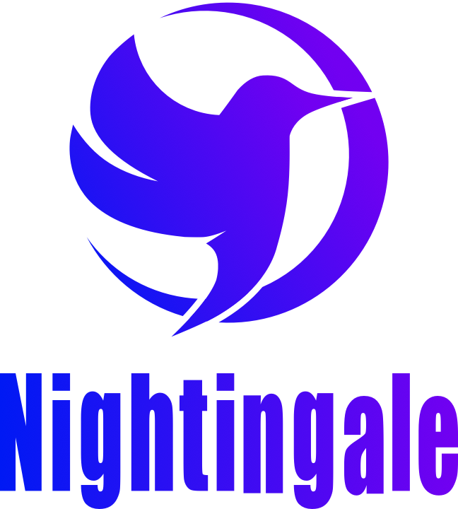
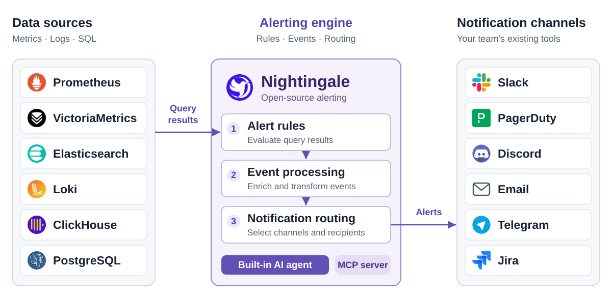
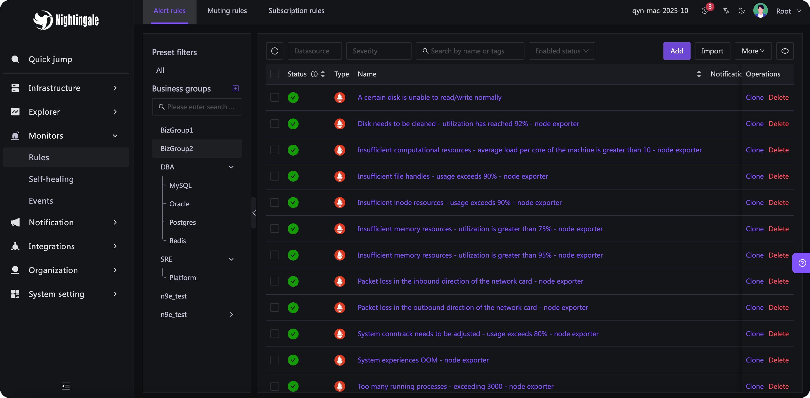

<p align="center">
  <a href="https://github.com/ccfos/nightingale">
    
  </a>
</p>

<p align="center">
  <b>既存のスタックのための、オープンソースのアラート基盤</b>
</p>

<p align="center">
  <a href="https://github.com/ccfos/nightingale/releases"></a>
  <a href="LICENSE"></a>
  <a href="https://github.com/ccfos/nightingale/stargazers"></a>
  <a href="https://hub.docker.com/r/flashcatcloud/nightingale"></a>
  <a href="https://join.slack.com/t/n9e/shared_invite/zt-480klxytf-P9qm3C1M87kDmRPp_H30Kw"></a>
</p>

<p align="center">
  <a href="#クイックスタート">クイックスタート</a> ·
  <a href="https://n9e.github.io/docs">ドキュメント</a> ·
  <a href="https://n9e.github.io/download">ダウンロード</a> ·
  <a href="https://github.com/ccfos/nightingale/releases">リリース</a> ·
  <a href="#コミュニティ">コミュニティ</a>
</p>

[English](README.md) | [中文](README_zh.md) | [日本語](README_ja.md)

Nightingale は、アラートルール、イベント処理、通知のルーティングを 1 か所にまとめます。Prometheus、VictoriaMetrics、Elasticsearch、Loki、ClickHouse など、すでに運用しているデータソースを接続し、Slack、PagerDuty、チームが使っている既存のツールにアラートを届けます。

**セルフホスト · Apache-2.0 · AI エージェント内蔵 · MCP サーバー**



## なぜ Nightingale なのか？

- **アラートの責任をチームに持たせます。** ルールをビジネスグループに整理し、チームに権限を割り当て、ルールと通知の設定を UI と API で管理できます。
- **散らばったアラートを 1 か所にまとめます。** 既存のコレクター、ストレージ、Grafana のダッシュボードはそのままに、メトリクス、ログ、SQL のデータソースに対してルールを評価します。
- **アラートに何が起きたかを把握できます。** ルールの評価記録、過去のイベント、通知の結果を確認して、クエリから配信までを追跡できます。

## クイックスタート

Git と Docker Compose がインストールされていれば、同梱の評価用スタックを起動できます。

```bash
git clone https://github.com/ccfos/nightingale.git
cd nightingale/docker/compose-bridge
docker compose up -d
```

これで Nightingale、MySQL、Redis、VictoriaMetrics、Categraf が起動します。[http://localhost:17000](http://localhost:17000) を開き、**`root` / `root.2020`** でサインインしてください。

最初のアラートを受け取るには：

1. **データソースを接続します。** 既存の Prometheus 互換のエンドポイントを追加するか、この Compose スタックの VictoriaMetrics インスタンスには `http://victoriametrics:8428` を使います。
2. **アラートルールを作成します。** ビジネスグループとデータソースを選び、PromQL の式を入力します。常に発火するテストには、`vector(1) > 0` を使い、持続時間を `0` に設定します。
3. **配信を設定します。** 通知チャネルを設定し、通知ルールを作成して、アラートルールに紐付けます。テスト通知が届くことを確認したら、テスト用のアラートを無効にします。

Compose スタックは例示用の認証情報を使い、ローカルでの評価のためにサービスのポートを公開しています。共有ホストや公開ホストにデプロイする前に、認証情報を変更し、ネットワークのアクセスを見直してください。Nightingale のほかの実行方法については、[デプロイの選択肢](#デプロイ)をご覧ください。

## スタックへの組み込み方

Nightingale は、データソースにクエリを実行し、アラートの条件を評価し、イベントを処理して、通知をルーティングします。既存のデータは、今のストアに置いたままです。

可視化には Grafana を、スケジュール、エスカレーション、インシデント対応にはオンコールのプラットフォームを引き続き使ってください。Nightingale には、アラートと一緒にデータを調べたいチームのためのダッシュボードも含まれています。

監視スタックがない状態から始めますか？ スタンドアロンの構成には、小規模な単一インスタンスのデプロイ向けに、オプションの組み込み TSDB が含まれています。[Categraf](https://github.com/flashcatcloud/categraf) は、ホスト、ミドルウェア、データベース、ネットワーク機器のための、オプションのコレクターです。

## 主な機能

| 機能 | できること |
| --- | --- |
| データソースをまたいだアラート | PromQL、ログのクエリ、SQL で条件を定義します。同じ種類のデータソースの複数のインスタンスに、1 つのルールを適用できます。 |
| チームによる所有 | ルールとダッシュボードをビジネスグループでまとめ、チームに権限を割り当て、サインインに OIDC、OAuth2、LDAP、CAS を接続できます。 |
| イベントの処理とルーティング | 通知のミュート、アラートの購読、ラベルの付加や書き換えを行い、条件付きのパイプラインでイベントをルーティングします。 |
| アラートの実行記録 | 評価のクエリと結果、アクティブなイベントと過去のイベント、通知の配信記録を確認できます。 |
| 再利用できるインテグレーション | 同梱のコレクター設定、アラートルール、ダッシュボードから始められます。有効にする前に、お使いの環境に合わせてクエリとしきい値を確認してください。 |
| 分散評価 | ルールを複数のアラートエンジンに分散し、`n9e-edge` を使ってリモートのデータソースの近くでアラートを評価します。 |

通知のインテグレーションには **Slack、PagerDuty、Discord、Email、Telegram、Mattermost、Jira、Jira Service Management** があり、独自の送信先には HTTP の Webhook とスクリプトを使えます。設定の詳細は、[ネイティブ通知チャネルのリファレンス](doc/api/notify-channel-native.md)をご覧ください。

自動での対応には、[ibex](https://github.com/flashcatcloud/ibex) を接続すると、アラートの発火時にあらかじめ定義した修復スクリプトを実行できます。

<a id="-mcp-server"></a>
<a id="ai-assistant-and-mcp"></a>

## 内蔵の AI エージェント

Nightingale には、Web UI で直接使える AI エージェントが含まれています。エージェントは Nightingale の中で動作し、ツールを呼び出して監視データと設定を調べ、複数のステップでタスクを進めます。

- **アラートを調査します。** 関連するメトリクスとログをクエリし、影響を受けたホストを調べ、取得したデータを使って結果を説明します。
- **アラートの処理をトラブルシューティングします。** ルール、評価のログ、ミュートの設定、イベント処理、通知の結果を調べ、アラートが発火しなかった理由や送信先に届かなかった理由を見つけます。
- **設定を作成・更新します。** 会話を通じて、アラートルールとダッシュボードを作り、PromQL と SQL を生成し、通知ルール、ミュート、購読を設定します。既存のアラートルールとダッシュボードを更新する内蔵ツールは、変更案を提示して確認を求めます。
- **Skills で拡張できます。** 同梱の Skills は、よくある監視のワークフローをカバーしています。チームの手順、参考資料、スクリプトを、Git からインポートした Skills も含めて、カスタムの Skills として追加できます。

例：

> このアラートはなぜ発火したの？ 発火した時刻の前後で、影響を受けたホストのメトリクスとログを確認して。

> 本番ホストのメモリ使用率のアラートを作成して、Slack でチームに通知して。

始めるには、モデルのエンドポイントを設定します。エージェントは、OpenAI 互換の API、Claude、Gemini、互換性のあるセルフホストのモデルに対応しています。モデルのサービスと認証情報はあなたが選びます。中核のアラート機能は、エージェントとは独立して動作します。

[モデルプロバイダーの設定](doc/api/ai-llm-config.md) · [Skill の管理](doc/api/ai-skill.md) · [同梱の Skills](aiagent/skill/embedded/builtin)

### 外部エージェントとの接続

- **MCP** を使うと、外部のアシスタントから Nightingale のツールを呼び出せます。サーバーは Nightingale の中の `/mcp` で動作し、デフォルトでは読み取り用のツールを公開し、呼び出し元の既存の API 権限を適用します。書き込み用のツールには明示的な設定が必要です。[MCP のセットアップ](doc/api/mcp-server.md)をご覧ください。
- **A2A** を使うと、ほかのエージェントが Nightingale の内蔵エージェントにタスクを委任できます。[A2A の連携](doc/api/a2a-integration.md)をご覧ください。

### Cursor プラグイン

このリポジトリには、ご自身の Nightingale のデプロイの内蔵 MCP サーバーに接続する Cursor プラグインも含まれています。プラグインは Streamable HTTP を使い、あなたの Nightingale アカウントと同じ権限で動作します。

**Nightingale を準備します。** `[HTTP.TokenAuth].Enable` を有効にし、`[HTTP.A2A].Disable` と `DisableMCP` は未設定のままか `false` にして、**個人センター → Token 管理** で個人用のトークンを作成します。Docker Compose の例の中には、トークン認証を無効にしているものがあります。実際にデプロイする設定を確認してください。サーバーの設定については、[MCP のセットアップ](doc/api/mcp-server.md)をご覧ください。

**リポジトリからインストールします。** Cursor で **Customize → Plugins → Add → From Local Repository** を開き、これらのプラグインのファイルを含むチェックアウトを選択します。`n9e` マーケットプレイスは `nightingale` という 1 つのプラグインを公開しています。**Add** を選んでインストールしてください。`.cursor-plugin/marketplace.json` が、リポジトリからのインストールのエントリーを提供します。リポジトリからのインポートは Git のリビジョンを使うので、インポートする前に、チェックアウトでプラグインのファイルをコミットしてください。これは、公開の Marketplace に掲載される前でも動作します。

コミットしていない変更をテストするには、代わりにプラグインの設定を Cursor のローカルプラグインのディレクトリにコピーします。macOS または Linux では、リポジトリのルートから次のコマンドを実行します。

```bash
mkdir -p ~/.cursor/plugins/local/nightingale/.cursor-plugin
cp .cursor-plugin/plugin.json ~/.cursor/plugins/local/nightingale/.cursor-plugin/
cp mcp.json ~/.cursor/plugins/local/nightingale/
```

ほかのローカルプラグインがすでにそのパスを使っている場合は、別のフォルダー名を使ってください。Cursor は、`~/.cursor/plugins/local` の外を指すローカルプラグインのシンボリックリンクをスキップします。Cursor を再起動するか **Developer: Reload Window** を実行してから **Customize** を開き、Nightingale のプラグインとその MCP サーバーが表示されることを確認します。このローカルインストールは、Marketplace への掲載に依存しません。

**インスタンスを設定します。** **Customize → Plugins → nightingale → Configure** を開き、以下の変数を設定します。チームに配布するプラグインの場合は、管理者が **Dashboard → Plugins → Configure** で設定します。

| 変数 | 値 |
| --- | --- |
| `N9E_MCP_URL` | `https://n9e.example.com/mcp` のような完全なエンドポイントです。`/mcp` を含め、クライアントから到達できるインスタンスのアドレスを使ってください。 |
| `N9E_TOKEN` | Nightingale の個人用トークンで、`X-User-Token` として送信されます。 |

ローカルの Nightingale のプロセスの場合、エンドポイントは通常 `http://127.0.0.1:17000/mcp` です。リモートの接続には HTTPS を使ってください。マニフェストが宣言するのは設定のフィールドだけで、`mcp.json` にはプレースホルダーが入っています。実際のトークンは、このリポジトリではなく、ご自身の Cursor の設定に保管してください。チームに配布するプラグインの変数はチームで共有されるため、その共有の接続に使う Nightingale のアカウントと権限は、それに応じて選んでください。

**接続を確認します。** **Customize** でプラグインの MCP サーバーを有効にし、接続されることを確認します。Cursor はプラグインの MCP の名前にプレフィックスを付けるため、`plugin-nightingale-nightingale` と表示されることがあります。変数を保存した後も **Connecting** のままの場合は、MCP のエントリーを開いて **Reload** を選びます。ツールの一覧を表示してから、次のように尋ねてみてください。

> Nightingale で私がアクセスできるビジネスグループを一覧にして。

> 今発火しているアラートはどれ？ 重要度ごとにまとめて。

結果は、同じユーザーが Nightingale で見られるものと一致するはずです。読み取り用のツールはデフォルトで有効です。サーバー側の書き込み用ツールの設定は、[MCP のセットアップ](doc/api/mcp-server.md#tools-and-permissions)で説明しています。`401` の応答は、トークンがない、無効である、またはトークン認証が無効になっていることを意味します。`404` は通常、エンドポイントかリバースプロキシのルートが間違っていることを意味します。`/api/n9e/mcp` ではなく、`/mcp` でなければなりません。

クライアントを直接設定する方法や OAuth については、[MCP のセットアップ](doc/api/mcp-server.md)をご覧ください。プラグインの構成、設定の変数、ローカルインストールは、[Cursor のプラグインのリファレンス](https://cursor.com/docs/reference/plugins)と[ローカル開発のガイド](https://cursor.com/docs/plugins#test-plugins-locally)に従っています。

## 製品のスクリーンショット

データソースとビジネスグループごとにアラートルールを管理します。



## デプロイ

| 選択肢 | ここから始める |
| --- | --- |
| Docker Compose によるローカルでの評価 | [同梱の Compose スタック](docker/compose-bridge/docker-compose.yaml) |
| amd64 と arm64 向けの Linux バイナリ | [リリースのダウンロード](https://github.com/ccfos/nightingale/releases)と[設定のリファレンス](etc/config.toml) |
| Kubernetes | [Helm チャートとインストール手順](https://github.com/flashcatcloud/n9e-helm) |

本番環境では、リリースを固定し、認証情報と TLS を設定し、メタデータのデータベースをバックアップし、ルールの評価と通知の失敗を監視してください。複数の Nightingale インスタンスは、メタデータのデータベースと Redis を共有します。複数インスタンスのデプロイには、外部の時系列ストレージを使ってください。組み込みの TSDB は、1 つのインスタンスのローカルディスクにデータを保存します。

詳しいガイダンスとサポート対象のバージョンについては、[ドキュメント](https://n9e.github.io/docs)、[インストールガイド](https://n9e.github.io/docs/install/overview)、[リリースノート](https://github.com/ccfos/nightingale/releases)、[セキュリティポリシー](SECURITY.md)をご覧ください。

## FAQ

**コレクターを置き換えたり、監視データを移動したりする必要はありますか？**

いいえ。Nightingale は既存のデータソースに直接クエリを実行できます。エクスポーターとコレクターはそのまま使ってください。収集やローカルのストレージが必要なときは、Categraf と組み込みの TSDB を使えます。

**既存の Prometheus のアラートルールをインポートできますか？**

はい。ルールのインポートは、式、持続時間、ラベル、アノテーションを含む Prometheus の YAML に対応しています。変換されたルールを確認し、通知のルーティングは Nightingale で組み直してください。インポートは `alertmanager.yml` の完全な変換ではありません。通知を切り替える前の評価期間中は、両方のシステムを並行して動かしてください。

**Git と CI でルールを管理できますか？**

ルールは JSON としてエクスポートでき、HTTP API で作成・更新できるので、バージョン管理された設定を中心にしたワークフローを構築できます。Nightingale には現在、ルールの変更履歴や以前のリビジョンへのロールバックの機能は組み込まれていません。

**AI は必須ですか？ また、モデルへのリクエストはどこに送られますか？**

アラート機能は AI なしで動作します。内蔵のアシスタントは、プロンプトとそれが使うデータを、設定したモデルのエンドポイントに送信します。ご自身のネットワーク内でホストしているモデルも使えます。外部の MCP クライアントは、それぞれのモデルの設定を使います。モデルのサービスの認証情報と利用料金は、ご自身で管理してください。

**Nightingale はオンコールのスケジュールとエスカレーションを提供していますか？**

スケジュール、エスカレーションポリシー、インシデント対応には、PagerDuty などのオンコールのプラットフォームを接続してください。Nightingale は、ルールの評価、イベントの処理、通知のルーティングを担当します。

## コミュニティ

質問、バグ報告、ドキュメントの改善、コントリビューションを、英語で歓迎しています。

- [GitHub Discussions](https://github.com/ccfos/nightingale/discussions) — 質問やアイデアの共有。
- [GitHub Issues](https://github.com/ccfos/nightingale/issues) — バグの報告と機能のリクエスト。バージョン、デプロイの方法、再現の手順を含めてください。
- [Slack](https://join.slack.com/t/n9e/shared_invite/zt-480klxytf-P9qm3C1M87kDmRPp_H30Kw) — コミュニティへの参加。
- [導入事例の報告](https://github.com/ccfos/nightingale/issues/897) — ほかの人が Nightingale をどう使っているかを知り、ご自身の経験を共有できます。
- [セキュリティポリシー](SECURITY.md) — 脆弱性の非公開での報告と、サポート対象のバージョンの確認。

大きな変更については、プルリクエストを送る前に issue を作成して、進め方を議論してください。[行動規範](CODE_OF_CONDUCT.md)に従ってください。

Nightingale はもともと DiDi で開発され、2022 年に CCF ODC に寄贈されました。[プロジェクトのガバナンス](doc/community-governance.md)、[コミッター](doc/committers.md)、[コントリビューター](https://github.com/ccfos/nightingale/graphs/contributors)についてご覧ください。

<a href="https://github.com/ccfos/nightingale/graphs/contributors">
  
</a>

## スターの推移

[](https://star-history.dera.page/#ccfos/nightingale&Date)

## ライセンス

Nightingale は [Apache License 2.0](LICENSE) のもとで提供されています。


