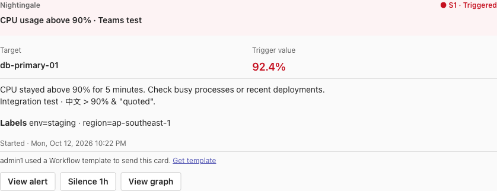
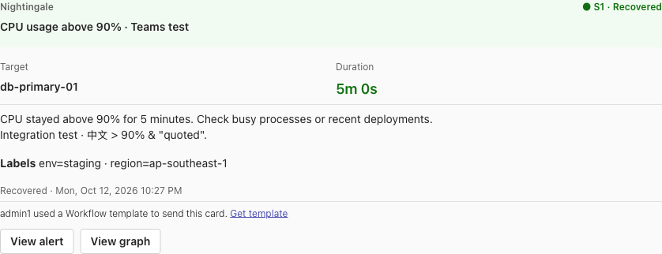

# Native notification channels (Jira, ...)

Native channels are notification channels whose `request_type` equals their `ident` and whose provider builds the request itself (instead of the generic HTTP URL + body template): **Jira** (`request_type=jira`), **Discord** (`request_type=discord`) and **JSM Alert** (`request_type=jsm_alert`). Slack and Mattermost follow the same pattern.

Differences from `request_type=http` channels:

- Templates are rendered as **plain text** (no JSON escaping), because the provider builds the JSON payload itself.
- Success is decided per third-party API (for example Jira returns `201` / `204`), with retries on `429` / `5xx` and `Retry-After` honoured (capped at 30s per wait).
- A legacy channel with the same ident but `request_type=http` (a hand-made webhook) keeps working unchanged through the callback fallback.

## Jira channel config

`request_config.jira_request_config`:

| Field | Description |
|---|---|
| `deployment_type` | `cloud` (default). Data Center is not supported yet |
| `site_url` | Jira site URL as opened in the browser, e.g. `https://your-domain.atlassian.net` (no `/rest/api`) |
| `token_type` | `scoped` (default): scoped API token or service-account token, sent through `https://api.atlassian.com/ex/jira/{cloudId}`; `classic`: classic API token, sent to `site_url` |
| `email` | Email of the account (or service account) that owns the token |
| `api_token` | API token. Supports variable references such as `{{.jira_token}}` |
| `cloud_id` | Optional. When empty it is fetched from `{site_url}/_edge/tenant_info` |
| `proxy` / `timeout` (ms) / `retry_times` / `retry_sleep` (ms) / `insecure_skip_verify` | Network settings |

## Jira params in a notify rule

`notify_configs[].params` (all values are strings; list / map values are JSON strings):

| Key | Required | Description |
|---|---|---|
| `project_key` | yes | Project key, e.g. `OPS` |
| `issue_type` | yes | Issue type name, e.g. `Bug` |
| `on_resolve` | no | `close` (default: comment and transition to a Done status), `comment`, `none` |
| `resolve_transition` | no | Transition name or id used to close; empty = pick a transition to the Done category automatically |
| `on_repeat` | no | `none` (default) or `comment`: what to do when the alert fires again while the issue is open. Once the issue is closed, the same alert firing again creates a new issue (closed issues are never reopened) |
| `priority_map` | no | JSON, severity → priority name, e.g. `{"1":"Highest","2":"High"}` |
| `labels` | no | JSON array of extra labels |
| `tags_as_labels` | no | `true` to add alert tags as labels (spaces become `_`, at most 20) |
| `fields` | no | JSON object of extra fields, e.g. `{"customfield_10010":"{\"value\":\"prod\"}"}`; a value that is valid JSON is sent as JSON, otherwise as text |

Issues are deduplicated with the label `eventHash=<event hash>`: repeated notifications of the same alert never create a second open issue.

The message template of a Jira channel has two fields: `title` (issue summary, max 255) and `content` (description; the rendering of the recovery event is used as the recovery comment).

## Discord channel

A built-in `Discord` channel (`ident=discord`, `request_type=discord`) is seeded on startup: the media type needs no credentials, the webhook URL is filled in each notify rule.

`request_config.discord_request_config` (optional, defaults for every rule): `username`, `avatar_url`, `silent` (send without push / desktop notifications), plus `proxy` / `timeout` / `retry_times` / `retry_sleep`.

Notify rule params:

| Key | Required | Description |
|---|---|---|
| `webhook_url` | yes | `https://discord.com/api/webhooks/<id>/<token>`; supports `{{.variable_name}}` |
| `bot_name` | no | A name for this webhook; shown as the notification target and used to reuse it in other rules |
| `target` | no | `channel` (default), `forum_post` (create a forum post per notification) or `thread` (existing thread / forum post) |
| `thread_name` | for `forum_post` | Post title, supports template variables such as `{{$event.RuleName}}` |
| `thread_id` | for `thread` | Numeric thread ID |

The message is one embed: title (template field `title`, or `[S2] Triggered: <rule>`), the rendered `content` as the description, severity color, event detail link and timestamp. Nothing in it pings anyone: `@everyone` or `<@id>` in the alert text stays plain text. The notification record shows the rule's `bot_name` or the webhook URL with its token masked, never the full URL.

## Slack Webhook and Mattermost Webhook channels

Built-in `SlackWebhook` (`ident=slackwebhook`, `request_type=slackwebhook`) and `MattermostWebhook` (`ident=mattermostwebhook`, `request_type=mattermostwebhook`) channels are seeded on startup: the media type needs no credentials, the webhook URL is filled in each notify rule. An untouched legacy row with the same name (generic HTTP, seeded by older versions) is upgraded in place; user-edited rows are left alone.

- `request_config.slackwebhook_request_config` (optional): `proxy` / `timeout` / `retry_times` / `retry_sleep`. Webhooks of new Slack apps ignore name and icon overrides, so there are none.
- `request_config.mattermostwebhook_request_config` (optional): `username`, `icon` (an image URL or an emoji code such as `:bell:`; both need the matching override option turned on by a Mattermost admin), `insecure_skip_verify`, plus the network settings above.

Notify rule params (both channels):

| Key | Required | Description |
|---|---|---|
| `webhook_url` | yes | Slack: `https://hooks.slack.com/services/T.../B.../...`; Mattermost: `https://<server>/hooks/<id>`. Supports `{{.variable_name}}` |
| `bot_name` | no | A name for this webhook; shown as the notification target and used to reuse it in other rules |

The message is one attachment: severity color, a title linking to the event detail (`[S2] Triggered: <rule>`), the rendered `content` as the text, footer and time. Slack succeeds on 200 with the body `ok` (a 200 with any other body is a failure); errors come back as plain-text codes such as `invalid_token` or `no_service`. Mattermost errors are JSON with an `id` such as `web.incoming_webhook.invalid.app_error`. The default Slack template escapes `& < >` in alert fields with the `slackEscape` template function. The notification record shows the rule's `bot_name` or the webhook URL with its token masked.

## JSM Alert channel

Creates and closes alerts in Jira Service Management Operations (formerly Opsgenie) through the integration API `{api_url}/jsm/ops/integration/v2/alerts` with `Authorization: GenieKey <key>`. The key belongs to an **API integration** of a JSM team (team → Integrations → Add integration → API), so it decides which team gets the alert and is filled in each notify rule, like a webhook URL. A built-in `JSM Alert` channel (`ident=jsm_alert`, `request_type=jsm_alert`) is seeded on startup.

`request_config.jsm_alert_request_config` (optional): `api_url` (default `https://api.atlassian.com`), `priority_map` (severity → JSM priority, e.g. `{"1":"P1","2":"P3","3":"P5"}`; missing severities default to S1→P1, S2→P2, S3→P3 — JSM priorities are the same site-wide, so this is an organization-level setting on the media type, not per rule), plus `proxy` / `timeout` / `retry_times` / `retry_sleep`.

Notify rule params:

| Key | Required | Description |
|---|---|---|
| `api_key` | yes | Key of the JSM API integration; supports `{{.variable_name}}`. Same key as the legacy built-in `JSM Alert` HTTP channel |
| `bot_name` | no | A name for this key (e.g. the team name); shown as the notification target and used to reuse the key in other rules |

Behaviour: the alias is the event hash, so repeated notifications are deduplicated by JSM (the alert count goes up); recovery closes the alert by alias with the rendered recovery content as the note. `message` comes from the template field `title` (max 130), `description` from `content`; tags are the event labels, details carry labels and annotations, `entity` is the target ident and `source` is `Nightingale`. The API answers `202` and processes asynchronously (a turned-off integration still answers `202`), so every send polls the request status: up to 3s in production and 10s for test sends. A processing failure is a send failure with a hint; a request not processed in time is recorded as accepted; closing an alert that is no longer open is not a failure. The notification record shows `bot_name` or the key masked to its last 4 characters.

## Endpoints

### POST /api/n9e/notify-channel-config/check

Checks the credentials and permissions of a (possibly unsaved) channel config, item by item. Permission: same as `/notify-channel-config/test`.

Request:

```json
{ "config": { "ident": "jira", "request_type": "jira", "request_config": { "jira_request_config": { "site_url": "https://x.atlassian.net", "email": "bot@example.com", "api_token": "..." } } } }
```

Response `dat`:

```json
[
  { "name": "Cloud ID", "ok": true, "required": true, "skipped": false, "message": "a436116f-..." },
  { "name": "Credentials", "ok": true, "required": true, "skipped": false, "message": "" },
  { "name": "Account", "ok": true, "required": false, "skipped": false, "message": "Bot bot@example.com" },
  { "name": "Add comments", "ok": false, "required": false, "skipped": false, "message": "" }
]
```

`name` and hint messages are translated according to `X-Language`. Only a failed item with `required=true` means the config does not work.

### Jira dropdown data (saved channel)

Permission: logged-in user (same as the PagerDuty service list).

| Endpoint | Response `dat` |
|---|---|
| `GET /api/n9e/jira-project-list/:id` | `[{"id":"10000","key":"OPS","name":"Operations"}]` |
| `GET /api/n9e/jira-issue-type-list/:id?project=OPS` | `[{"id":"10001","name":"Bug","subtask":false}]` (sub-tasks excluded) |
| `GET /api/n9e/jira-issue-type-check/:id?project=OPS&issue_type=Bug` | `{"missing_permissions":["ADD_COMMENTS"],"required_fields":[{"fieldId":"customfield_10010","name":"Environment","required":true,"hasDefaultValue":false}]}` |
| `GET /api/n9e/jira-priority-list/:id` | `[{"id":"1","name":"Highest"}]` |

### Test endpoints

Both `POST /api/n9e/notify-channel-config/test` and `POST /api/n9e/notify-rule/test` accept `"with_recovery": true`: the events are sent once as firing and then once as recovered, which verifies the recovery flow (for Jira: comment and close).

For native channels the channel test response carries `detail` with the provider's action summary, e.g. `created OPS-12 https://x.atlassian.net/browse/OPS-12`. Each test send uses a one-off nonce in the Jira dedup key, so every test creates its own issue.

## Microsoft Teams

`ident=teams`, `request_type=teams`. A built-in Microsoft Teams channel is seeded on startup. `request_config.teams_request_config` contains the shared network settings. Each rule supplies `webhook_url` and optional `bot_name`; variable references are supported in the URL.

Use a Teams Workflows **When a Teams webhook request is received** trigger with **Anyone** access and a card-posting action. Copy the full signed URL, including query parameters. Nightingale sends an Adaptive Card 1.2 with a tinted status header, a separate rule title, target/value columns (duration on recovery), editable Markdown content, localized time and action buttons. The default `content` template contains notes and extra labels; status, title, target, value, time and links are rendered by the card, avoiding duplication. Custom `content` remains intact. View alert requires a valid site URL; Silence 1h appears only while firing, and View graph only for Prometheus events. A successful webhook response acknowledges submission; workflow run history provides the downstream delivery result. Entra bearer-token authentication is not implemented.

The title is capped at 256 characters and content at 4000; the complete serialized payload must not exceed 28 KB. Empty 2xx responses or `1` are successful. HTTP 429/5xx and legacy connector HTTP-200 throttling responses are retried. Notification targets and errors redact both query signatures and legacy URL credentials.

Sources: [Teams Workflows](https://learn.microsoft.com/en-us/microsoftteams/platform/webhooks-and-connectors/how-to/add-incoming-webhook), [Adaptive Card envelope](https://learn.microsoft.com/en-us/microsoftteams/platform/webhooks-and-connectors/how-to/connectors-using).

### Teams card previews

The following cards were delivered to a dedicated Teams test channel using the provider and built-in template. The example site URL demonstrates button rendering; it is not a live event destination.





### Teams setup and live verification

The Teams channel menu offers **Workflows → Send webhook alerts to a channel**. This template binds the selected team/channel, accepts requests from anyone holding the signed URL, and posts Adaptive Cards. Name the workflow, sign in to its Teams connection if prompted, save, then use **Copy webhook link**.

For a new Power Automate user, the embedded Workflows app can stay at a disabled Sign in/Save button while `prepareFlowOperations` or `onBehalfOfTokenBundle` returns `UserConsentMissing`. Open [Power Automate](https://make.powerautomate.com), finish the first-use **Get started** step, then reopen the workflow template in Teams.

`TestTeamsLive` is an opt-in smoke test. Set `NIGHTINGALE_TEAMS_WEBHOOK_URL` through the process environment and run `go test ./alert/sender/provider -run '^TestTeamsLive$' -v -count=1`. It posts one firing and one recovered notification using the built-in template. Optional variables are `NIGHTINGALE_TEAMS_PROXY` and `NIGHTINGALE_TEST_SITE_URL`. The test does not print the signed URL. Verify both cards in Teams and the two workflow runs; API acceptance alone does not prove delivery. Ordinary tests skip this test when the webhook variable is absent.

## Twilio SMS and voice

`ident=twilio`, `request_type=twilio`. Create a media type with `request_config.twilio_request_config`:

| Field | Description |
|---|---|
| `account_sid`, `auth_token` | Twilio account credentials; support variable references |
| `mode` | `sms` (default) or `voice`; create two media types to send both |
| `from` | SMS sender number / alphanumeric ID; voice requires a Twilio E.164 number |
| `messaging_service_sid` | SMS-only alternative to `from`; may also be used with a sender in that service |
| `voice`, `language` | Voice-only `<Say>` attributes; defaults `woman`, `en-US` |
| `proxy`, `timeout`, `retry_times`, `retry_sleep` | Shared network fields; only explicit 429 rejections are retried, zero retries disables retries |

Set `param_config.user_info.contact_key=phone`; rules select `user_ids` / `user_group_ids`. Recipients must use E.164 format, e.g. `+14155552671`; a number in any other format is reported as a failed recipient while the remaining recipients are still sent, and duplicate numbers are sent once. The frontend's Twilio preset supplies this contact mapping. Credential-bearing Twilio channels are created by the user, not seeded with placeholder credentials.

The `content` template is rendered as plain text, then URL-encoded for the Twilio API. Voice content is XML-escaped into inline TwiML `<Response><Say>...</Say></Response>`. Content must be 1–1600 characters; serialized voice TwiML must fit in 4000 characters. SMS uses `POST /2010-04-01/Accounts/{AccountSid}/Messages.json`; voice uses `Calls.json`. Both use HTTP Basic auth and form encoding.

A valid 201 response records **accepted**, the Message/Call SID and initial status. This is not final delivery or call completion; consult Twilio logs. A failed recipient does not prevent attempts to other recipients, and the result retains accepted submissions alongside the errors. Network failures, 5xx responses and invalid creation responses are not retried automatically because a request may already have created a billable SMS/call.

Sources: [Messages](https://www.twilio.com/docs/messaging/api/message-resource), [Calls](https://www.twilio.com/docs/voice/api/call-resource), [TwiML Say](https://www.twilio.com/docs/voice/twiml/say).

For new Twilio trials, custom SMS bodies can be restricted to Twilio-provided examples. Full alert-text testing requires an account that permits custom SMS content. Trial Voice supports `<Say>` with trial restrictions; verify the account's allowed destinations and API parameters before live testing. See [Twilio trial restrictions](https://www.twilio.com/docs/usage/trials) and [SMS trial API](https://www.twilio.com/docs/usage/trials/try-out-sms).

## Pushover

`ident=pushover`, `request_type=pushover`. Create a media type with `request_config.pushover_request_config`:

| Field | Description |
|---|---|
| `token` | API token of the Pushover application (30 letters or digits); supports variable references |
| `sound` | Optional notification sound; empty uses the recipient's default |
| `api_url` | Optional, defaults to `https://api.pushover.net` |
| `proxy`, `timeout`, `retry_times`, `retry_sleep` | Shared network fields |

Each rule supplies `user_key` (a user key or delivery group key, up to 50 comma-separated) and an optional `bot_name`.

The message is posted as a form to `/1/messages.json` with the credentials in the body, never in the URL. `title` is `[S1] Triggered: <rule>` (250 characters), `message` is the rendered `content` template as plain text (1024 characters), `timestamp` is the trigger or recovery time, and `url` links to the event. Priorities are fixed in the provider: S1→High (1), S2/S3→Normal (0), and recovery→Normal (0). There is no configurable severity mapping or Emergency repeat mode.

Success requires HTTP 200 with `"status":1`. As Pushover requires, 4xx responses are never retried (429 means the application's monthly limit is used up, and repeated bad requests get the IP blocked); 5xx responses are retried after at least 5 seconds.

Source: [Pushover Message API](https://pushover.net/api).

## ntfy

`ident=ntfy`, `request_type=ntfy`. A built-in ntfy channel is seeded on startup; with an empty config it publishes to the public `https://ntfy.sh` without authentication.

| Field (`request_config.ntfy_request_config`) | Description |
|---|---|
| `server_url` | Root address of the ntfy server; empty means `https://ntfy.sh` |
| `token` | Access token (`tk_...`), sent as a Bearer token |
| `username`, `password` | Basic authentication, alternative to `token` |
| `proxy`, `timeout`, `retry_times`, `retry_sleep`, `insecure_skip_verify` | Shared network fields |

Each rule supplies `topic` (1–64 letters, digits, `_` or `-`; the name only, not a URL) and an optional `bot_name`. On a public server the topic acts as a password, so notification records show the name or only the last 4 characters of the topic.

Nightingale publishes JSON to the server root: `title`, `message` (the rendered `content` template, plain text), `priority`, `tags` (an emoji shortcode plus the severity), `click` and `view` actions linking to the event (and Silence 1h while firing). Priorities are fixed in the provider: S1→Max (5), S2→High (4), S3→Default (3), and recovery→Default (3). The message is cut to 4096 **bytes** on a character boundary, because longer messages are turned into attachments by the server. HTTP 429 and 5xx are retried, except error code 42908 (daily message quota reached).

Sources: [ntfy publishing](https://docs.ntfy.sh/publish/), [error codes](https://github.com/binwiederhier/ntfy/blob/main/server/errors.go).

## Splunk On-Call (VictorOps)

`ident=splunk_oncall`, `request_type=splunk_oncall`. Create a media type with `request_config.splunk_oncall_request_config`:

| Field | Description |
|---|---|
| `api_key` | Key of the REST endpoint integration (Integrations > REST - Generic); supports variable references |
| `api_url` | Optional, defaults to `https://alert.victorops.com/integrations/generic/20131114/alert`. The full URL copied from the integration page (ending in `/<key>/$routing_key`) is accepted and trimmed |
| `proxy`, `timeout`, `retry_times`, `retry_sleep` | Shared network fields |

Each rule supplies `routing_key` (which team's escalation policy receives the alert) and an optional `bot_name`.

Every event is posted to `{api_url}/{api_key}/{routing_key}` with `entity_id` = event hash, `entity_display_name` = rendered `title`, `state_message` = rendered `content`, `host_name`, `monitoring_tool=Nightingale` and a `vo_annotate.u.Event details` link. Message types are fixed in the provider: S1→CRITICAL and S2/S3→WARNING. Whether WARNING creates an incident depends on the Splunk On-Call integration settings. A recovered event sends `message_type=RECOVERY` with the same `entity_id`, which resolves the incident. Test sends append a one-off nonce to `entity_id`, and `with_recovery` is supported.

A 2xx response whose body says `"result":"failure"` is treated as a failure. HTTP 429 and 5xx are retried. Errors redact the API key, which is part of the request URL.

Sources: [REST endpoint integration](https://help.splunk.com/en/splunk-observability-cloud/splunk-on-call/integrations-with-splunk-on-call/rest-endpoint-integration-for-splunk-on-call).

## LINE

`ident=line`, `request_type=line`. Uses the Messaging API of a LINE Official Account (LINE Notify was shut down in March 2025). Create a media type with `request_config.line_request_config`:

| Field | Description |
|---|---|
| `channel_access_token` | Channel access token of the Messaging API channel; supports variable references |
| `api_url` | Optional, defaults to `https://api.line.me` |
| `proxy`, `timeout`, `retry_times`, `retry_sleep` | Shared network fields |

Each rule supplies `to` — a user ID (`U...`), group ID (`C...`) or multi-person chat ID (`R...`), each followed by 32 hexadecimal characters — and an optional `bot_name`. The user must have added the official account as a friend, or the account must be a member of the group.

Nightingale calls `POST /v2/bot/message/push` with one text message: a status symbol and title, the rendered `content` template and the event link, cut to 5000 UTF-16 code units without cutting the link. Every notification carries its own `X-Line-Retry-Key`, reused across retries, so a retry after a timeout or 5xx cannot deliver twice; a 409 response means an earlier attempt was accepted and counts as success. HTTP 429 is retried unless the body says the monthly limit is reached.

Sources: [Send push message](https://developers.line.biz/en/reference/messaging-api/#send-push-message), [Retrying an API request](https://developers.line.biz/en/docs/messaging-api/retrying-api-request/).
